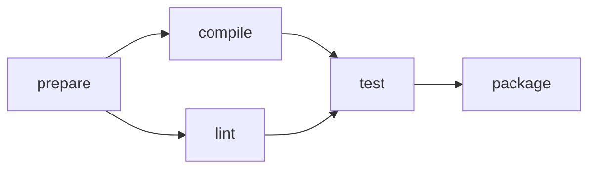

# Dependency-Graph Workflow Planner

English | [日本語](README.ja.md)

Input parsing, graph management, execution-order calculation, and JSON Lines construction run entirely in walz.
This is a virtual-time scheduler and does not launch real external jobs.
It combines existing GC, enums, Result, opaque types, loops, and text I/O without adding language, compiler, or runtime features.

```sh
just build-workflow
just workflow
just workflow input.tsv
just test-workflow
just test-workflow-stress      # 65,795行を含む I/O 負荷も両バックエンドで検証
```

Use `walz-lang` as the working directory. Node 24 or later, pnpm dependencies, and Wasmtime with Wasm GC support are required.
The ordinary CLI uses lightweight Core+JSPI output; tests check both Core+JSPI and Component.

## Input and Output

Fields are TAB-separated. Empty lines and lines beginning with `#` are ignored.

| Command | Meaning |
|---|---|
| `TASK id duration` | Declares a job; duration is ASCII decimal from 0–1,000,000, allowing leading zeros |
| `AFTER id prerequisite` | id waits for prerequisite to finish; registering the same edge again has no effect |
| `PLAN workers` | Outputs a plan assigning the current graph to 1–32 workers |

IDs are nonempty, at most 128 UTF-8 bytes, and contain no TAB or newline. Names use byte comparison without Unicode normalization.
Declare both jobs before registering AFTER. Self-dependencies are allowed and detected as cycles during PLAN.
Limits are 4,096 jobs and 65,536 edges. Together with duration limits, these keep plan times within signed i64 range.

Idle workers are processed in numeric order, choosing not-yet-started jobs whose prerequisites have all completed, in declaration order.
After assignment, time advances to the next completion; every job finishing then is completed before further assignment.
Zero-duration jobs follow the same rules. This is not an optimization algorithm guaranteeing the shortest makespan.

Successful TASK/AFTER commands produce no output. PLAN outputs one summary line followed by one result per job in declaration order.
Invalid input, duplicate names, unknown prerequisites, and capacity errors produce an error for that line and continue. Failed registration leaves the graph unchanged.
Input/output I/O failures return main's err and exit unsuccessfully. On success, main returns the number of lines read, including comments and empty lines.

```json
{"line":12,"ok":true,"kind":"plan","workers":2,"tasks":5,"makespan":12}
{"line":12,"kind":"job","id":"prepare","worker":0,"start":0,"finish":2}
{"line":12,"kind":"job","id":"compile","worker":0,"start":2,"finish":7}
{"line":12,"kind":"job","id":"lint","worker":1,"start":2,"finish":5}
{"line":12,"kind":"job","id":"test","worker":0,"start":7,"finish":11}
{"line":12,"kind":"job","id":"package","worker":0,"start":11,"finish":12}
```

This is [sample.tsv](sample.tsv) with two workers. One worker produces a makespan of 15.
If a cycle prevents progress, no partial plan is output; for example:

```json
{"line":7,"ok":false,"error":"cycle","detail":"downstream"}
```

Detail is **the first unfinished job in declaration order**. This includes jobs blocked by dependencies on a cycle; it does not necessarily identify a node on the cycle or a cycle path.
PLAN creates independent state, so replanning with a different worker count and adding jobs/dependencies afterward are supported.

## Implementation



| File | Responsibility |
|---|---|
| [domain.walz](domain.walz) | Command and Error enums |
| [parse.walz](parse.walz) | Strict parsing from bytes/text |
| [graph.walz](graph.walz) | Opaque Graph/Job/Link, growing arrays, hash indexes, and shared GC dependency lists |
| [queue.walz](queue.walz) | A fixed-capacity min-heap selecting the lowest job index in declaration order |
| [planner.walz](planner.walz) | In-degrees, reverse-dependency arrays, state transitions, a virtual event loop, and detection of cycle-blocked progress |
| [report.walz](report.walz) | JSON construction and asynchronous output |
| [program.walz](program.walz) | Distinguishes business/I/O errors and tracks line-number state |
| [main.walz](main.walz) | Stream fold and cleanup |
| [model.test.walz](model.test.walz) | 12 model tests running on Wasmtime |
| [queue.test.walz](queue.test.walz) | Three heap tests covering empty/single-element heaps, reverse-order insertion, and insertion during processing |
| [benchmark.walz](benchmark.walz) | Validation/measurement of large graphs without I/O |

Graphs and execution state use separate opaque types. Mutable fields sit behind APIs; planning algorithms do not access representations directly.
Multiple plans can use the same GC graph. Planning in-degrees, reverse edges, and heaps are not referenced by the resulting Run and can be reclaimed after computation.
Hash-index chains are not Job fields either, so retaining one Job does not retain unrelated Jobs.
Dependency cycles can also use GC references and are not modeled as cycles of owned values.
Futures/Streams follow existing explicit consumption rules; fold closes input on error.

## Validation

The independent JavaScript [reference implementation](../../../runtime/workflow-oracle.mjs) is compared through [execution tests](../../../runtime/workflow.test.mjs).
The reference uses Map/Set and completion times; the guest uses GC arrays, dependency lists, and state enums.

- Simultaneous completion, zero-duration dependencies, empty graphs, cycles/self-dependencies, replanning, and updates after planning.
- Japanese text, emoji, quotation marks, backslashes, NUL, and input chunks splitting UTF-8 sequences.
- Invalid lines, numeric/name boundaries, duplicates, undeclared names, and re-registering existing edges after reaching limits.
- A fixed seed with 240 jobs, 714 dependency registrations, and five worker counts.
- A 2,200-job chain and time 2,200,000,000, beyond i32 range.
- Rejection of the 4,097th job and 65,537th edge.
- I/O failures, cancellation while waiting for reads/writes, and withholding cancellation acknowledgement until cleanup completes.
- Twenty reuses of the same instance, with zero ABI allocations, owned handles, scopes, and similar state after calls.
- Jobs earlier in declaration order becoming ready during processing, existing references after hash collisions/rehashing, and GC reachability while retaining one Job.

Ordinary tests also process 65,536 edges through guest functions without I/O.
The stress version sends all 65,795 lines through text I/O. Measurements are saved in `target/workflow-validation/`.
These checks do not prove maximum GC heap usage or long-term reclamation rates.

The [implementation assessment](ASSESSMENT.md) records initial writing experience and limitations; [tuning results](TUNING.md) record improved measurements and reproduction instructions.
