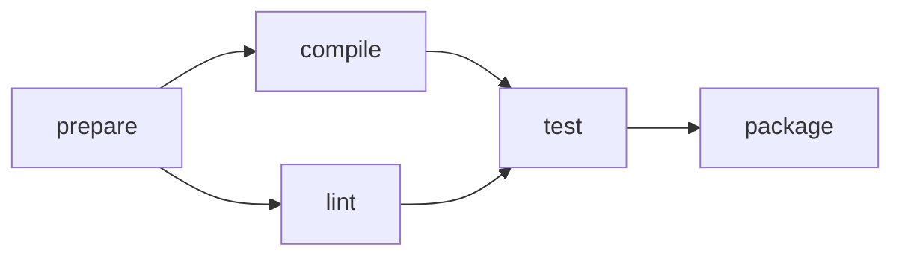

# 依存グラフのワークフロープランナー

wlt だけで入力の解析・グラフ管理・実行順の計算・JSON Lines の組み立てを行う。
仮想時刻上のスケジューラーであり、実際の外部ジョブを起動する機能ではない。
言語仕様・コンパイラ・ランタイムに新機能を追加せず、既存の GC、enum、Result、opaque、loop、text I/O を組み合わせた。

```sh
just build-workflow
just workflow
just workflow input.tsv
just test-workflow
just test-workflow-stress      # 65,795行を含む I/O 負荷も両バックエンドで検証
```

`wlt-lang` を作業ディレクトリにする。Node 24以降、pnpm の依存関係、Wasm GC 対応 Wasmtime が必要。
通常の CLI は軽い Core＋JSPI 出力を使う。テストでは Core＋JSPI と Component の両方を検証する。

## 入出力

TAB 区切り。空行と、先頭が `#` の行を無視する。

| コマンド | 意味 |
|---|---|
| `TASK id duration` | ジョブを宣言。時間は ASCII 十進数の0〜1,000,000、先頭の0を許す |
| `AFTER id prerequisite` | id が prerequisite の完了を待つ。同じ辺の再登録は何もしない |
| `PLAN workers` | 現在のグラフを1〜32ワーカーへ割り当てた計画を出力 |

id は非空・最大128 UTF-8 byteで、TAB・改行を含まない。同じ名前はバイト単位で比較し、Unicode 正規化は行わない。
両ジョブを宣言してから AFTER を登録する。自己依存は登録でき、PLAN 時に循環として検出する。
最大4,096ジョブ、65,536辺。数量上限と合わせ、計画の時刻は符号付き i64 の範囲内に収まる。

空いているワーカーを番号順に処理し、依存先がすべて完了した未開始ジョブを宣言順に選ぶ。
割当て後、次の完了時刻へ進め、その時刻に完了するジョブをすべて確定してから次の割当てを行う。
ゼロ時間のジョブもこの規則に従う。最短の総時間を保証する最適化アルゴリズムではない。

TASK / AFTER の成功時は出力しない。PLAN は要約1行と、宣言順のジョブごとの結果を出力する。
不正な入力・重複名・不明な依存先・容量超過は、その行のエラーを出して次の行を処理する。失敗した登録でグラフは変更しない。
入力・出力の I/O 失敗は main の err と失敗終了にする。正常時の main の成功値は、コメントや空行を含む読んだ行数。

```json
{"line":12,"ok":true,"kind":"plan","workers":2,"tasks":5,"makespan":12}
{"line":12,"kind":"job","id":"prepare","worker":0,"start":0,"finish":2}
{"line":12,"kind":"job","id":"compile","worker":0,"start":2,"finish":7}
{"line":12,"kind":"job","id":"lint","worker":1,"start":2,"finish":5}
{"line":12,"kind":"job","id":"test","worker":0,"start":7,"finish":11}
{"line":12,"kind":"job","id":"package","worker":0,"start":11,"finish":12}
```

[sample.tsv](sample.tsv) の2ワーカーの場合。1ワーカーでは makespan は15になる。
循環で進めなくなった場合は、途中までの計画を出さず、例えば次を出す。

```json
{"line":7,"ok":false,"error":"cycle","detail":"downstream"}
```

detail は**宣言順で最初の未完了ジョブ**。循環に依存して止まったジョブも含み、循環上のノードそのものや循環経路を示すとは限らない。
PLAN は独立した状態を作るので、ワーカー数を変えた再計画や、後からのジョブ・依存辺追加も可能。

## 実装



| ファイル | 担当 |
|---|---|
| [domain.wlt](domain.wlt) | Command と Error の enum |
| [parse.wlt](parse.wlt) | bytes/text からの厳密な入力解析 |
| [graph.wlt](graph.wlt) | opaque な Graph / Job / Link、拡張する配列とハッシュ索引、共有 GC の依存リスト |
| [queue.wlt](queue.wlt) | 宣言順の最小ジョブ番号を選ぶ、容量固定の min-heap |
| [planner.wlt](planner.wlt) | 入次数・逆向きの依存配列、状態遷移、仮想イベントループ、循環による停止検出 |
| [report.wlt](report.wlt) | JSON の構築と非同期書き出し |
| [program.wlt](program.wlt) | 業務エラーと I/O エラーの区別、行番号の状態 |
| [main.wlt](main.wlt) | Stream の fold と終了処理 |
| [model.test.wlt](model.test.wlt) | Wasmtime で動く12件のモデルテスト |
| [queue.test.wlt](queue.test.wlt) | 空・単一要素・逆順挿入・途中挿入を含む3件のヒープテスト |
| [benchmark.wlt](benchmark.wlt) | I/O を経由しない大きいグラフの検証・計測 |

グラフと実行状態は別の opaque 型にした。可変フィールドは API の背後に置き、計画アルゴリズムから表現へ直接アクセスしない。
同じ GC グラフに対して複数の計画を作れる。計画用の入次数・逆向き辺・ヒープは結果の Run から参照せず、計算後は回収可能になる。
ハッシュ索引の連結も Job のフィールドに置かず、1件の Job の保持で無関係な Job を保持しない。
依存グラフの循環も GC 参照で表現でき、所有値の循環としてモデル化していない。
Future / Stream は既存の明示的な消費規則に従い、fold のエラー時には入力を閉じる。

## 検証

JavaScript の独立した [参照実装](../../../runtime/workflow-oracle.mjs) と、[実行テスト](../../../runtime/workflow.test.mjs)で照合する。
参照実装は Map / Set と完了時刻、ゲストは GC 配列・依存リスト・状態 enum を使う。

- 同時完了、ゼロ時間の依存、空グラフ、循環と自己依存、再計画、計画後の更新。
- 日本語・絵文字・引用符・backslash・NUL、UTF-8 の途中で切れる入力チャンク。
- 不正な行、数値・名前の境界、重複、未宣言名、上限到達後の既存辺の再登録。
- 固定 seed の240ジョブ・714回の依存登録と、5通りのワーカー数。
- 2,200ジョブのチェーン、i32 の範囲を超える2,200,000,000の時刻。
- 4,097件目のジョブと65,537本目の辺の拒否。
- I/O 失敗、読み取り待ち／書き出し待ちの取消し、終了処理完了まで取消しを通知しないこと。
- 同じインスタンスの20回の再利用。呼出し後の ABI 割当て・所有 handle・scope 等が0であること。
- 宣言順が早いジョブの途中解禁、ハッシュ衝突・再ハッシュ後の既存参照、1件の Job を保持した場合の GC 到達可能性。

通常テストでも65,536辺の処理を I/O なしのゲスト関数で検査する。
stress 版では65,795行をすべて text I/O から通す。測定値は `target/workflow-validation/` に保存する。
GC ヒープの最大使用量や長時間の回収率を証明する検査ではない。

初回の書き心地と制限は [実装評価](ASSESSMENT.md)、改善後の計測と再現方法は [チューニング結果](TUNING.md) に記録する。
