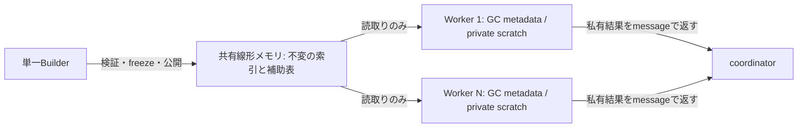

**WLTで狙うなら、構築後に変更しない簡潔データ構造を共有し、範囲統計や複数条件の集計をまとめて並列処理するライブラリが有力です。** 最初はrank/select付きbitvector、その上に小さい値域のWavelet Matrixを作り、独立したクエリのバッチをWorkerへ分配します。用途は検索画面のファセット集計、カテゴリ別の範囲頻度、価格・スコアの分位点などです。単発のrankやSIMD命令の速さより、索引を再利用し、中間配列と境界コピーを減らすことが製品上の勝ち筋になります。ここでいう簡潔データ構造はsuccinct data structuresを指しますが、数学的な最小空間の達成を主張するものではありません。調査日は2026-11-08で、新しい速度計測・実装は行っていません。

既存のWLT計測には、この方向を試す根拠があります。2026-11-06のApple M5・Node 24.21.0 / V8 13.6では、16,384要素の保持済みSIMDカーネルがJS対照に対して合計4.58倍、内積4.08倍、bitmap交差件数5.56倍、bytes検索の不一致7.09倍でした。ただし初期転送とpackは時間外です。一括転送の改善後も、入力コピー・GC変換・packを毎回含む公開APIはJS対照より遅いままでした。これは既存のライブラリへの勝利を示す値ではなく、**データを保持するAPIに価値がある**という証拠です。([保存された計測条件と結果](/Users/mz/ghq/github.com/mizchi/wlt-lang/docs/simd-kernels.md:55))

`mizchi/jsimd`は具体的な参考になります。取得時のcommit `2cf51e8`にはRankSelectBitVector、WaveletMatrixUint8/16/32、EliasFanoSequenceが公開済みです。WLT側では、まず次の範囲へ絞るのが妥当です。([jsimd公開API](https://github.com/mizchi/jsimd/blob/2cf51e8885314764dcb44b6469899d95f204b148/packages/jsimd/README.md))

| 順序 | データ構造とAPI | 最初に狙う仕事 | 判断上の注意 |
|---|---|---|---|
| 1 | 不変bitvector、rank/select、batch版 | bitmap条件の件数・位置取得、後続索引の基礎 | 単発rankのFFIは避け、indexed JSと比較する |
| 2 | u8相当のWavelet Matrix、rangeFreq / quantile | 時間範囲内のカテゴリ頻度・分位点を反復照会 | 入力値域を検査する。i32型だけでu8範囲は保証されない |
| 3 | read-only query batchのWorker pool | 同じ索引への多数の独立照会 | 索引を複製せず共有し、結果だけ返す |
| 後続 | Elias–Fano、必要なら圧縮表現の選択 | 単調なposting / timestamp列の検索 | 生配列のaccess / decodeより速いとは限らない |

Wavelet Matrixは、複数種類の範囲統計を一つの索引から求める用途に向きます。u8相当なら8levelから始められ、u32の32levelより構築と問い合わせを小さくできます。一方、jsimdのu32版は約4.25 bytes/valueで、生のUint32Arrayの4 bytes/valueより必ず小さくなるわけではありません。direct accessや値ごとの位置検索には、生配列や専用の位置索引が強いという既存測定もあります。全面的な配列置換ではなく、反復する範囲頻度・分位点を対象にします。([Wavelet Matrixのlayoutと比較](https://github.com/mizchi/jsimd/blob/2cf51e8885314764dcb44b6469899d95f204b148/packages/jsimd/src/wavelet-matrix-uint32/README.md))

Elias–Fanoは単調列の圧縮検索として後続候補です。LOUDSはjsimdで棄却された実験であり、最初の実装対象には勧めません。公開実験では親取得を直接Uint32Array表と比較し、直接表が6.70倍速い条件がありました。圧縮した表現はメモリやcacheに寄与しても、rank/selectの依存ロードが実行時間を増やします。([Elias–Fanoの契約](https://github.com/mizchi/jsimd/blob/2cf51e8885314764dcb44b6469899d95f204b148/packages/jsimd/src/elias-fano-sequence/README.md)、[LOUDSの棄却理由](https://github.com/mizchi/jsimd/blob/2cf51e8885314764dcb44b6469899d95f204b148/experiments/louds-topology/README.md))

移植前に直すべき比較条件も見つかりました。rank/selectのREADMEはselectがprefix索引を二分探索して最大16wordを読むと説明しますが、取得したZig実装の`select1`と`select0`は索引引数を使わず、先頭からwordを走査します。また512bitごとのu32 prefixは、64 bytesのデータに4 bytesなので補助領域は約6.25%です。READMEの0.78%とは一致しません。今回README計測に使った生成物との一致は未確認のため、固定したソースから再ビルドして比較します。([READMEの説明](https://github.com/mizchi/jsimd/blob/2cf51e8885314764dcb44b6469899d95f204b148/packages/jsimd/src/rank-select-bit-vector/README.md#L73)、[select実装](https://github.com/mizchi/jsimd/blob/2cf51e8885314764dcb44b6469899d95f204b148/packages/jsimd/src/rank-select-bit-vector/kernels.zig#L36)、[索引領域の確保](https://github.com/mizchi/jsimd/blob/2cf51e8885314764dcb44b6469899d95f204b148/packages/jsimd/src/rank-select-bit-vector/mod.ts#L90))

WLT版では索引で対象blockを絞るselectを作れますが、同じ改善をJSにも適用して比較します。空blockでprefixが重複する場合のupper_bound、select0でpaddingを数えない末尾mask、半開区間rank、欠落時のselectという規約を先に固定します。アルゴリズム改善の利益をWLT自体の速度として扱わないためです。

WLTの実用上の特徴は、WATに近い整数・SIMD操作、単相化した型とクロージャ、GCで保持する複雑なメタデータを一つの検査済みプログラムにまとめられる点です。静的にリンクしたbitmap・rank・範囲索引が同じ格納形式を使い、処理間のコピーを減らす構成も候補です。ただしSIMDは他のWasm言語でも利用でき、現在のeffect/ownership解析は自動ベクトル化、noalias、一般的なループ融合を行いません。既存bitmapの対jsimd差にも、WLT側がベクトル累積して最後だけ還元する構成と、参照側が各blockで水平還元する構成の差が含まれます。([単相化](../docs/generics.md)、[現行optimizer](../src/optimize.rs)、[bitmap実装](../examples/simd-kernels/kernels.wlt))

並列版は、**索引本体とrank directory等の補助表を共有線形メモリに置き、各WorkerのGCには小さなdescriptorと私有scratchだけを置く**設計を勧めます。現行WLTのGC参照をWorker間で共有する仕組みはありません。線形メモリにGC pointerを格納せず、offset・length・bit-length・versionを使います。WLTは線形メモリの`v128.load`に既に対応していますが、GCのpacked byte配列から同じ命令で直接読むこととは別です。([現行threadsの範囲](../docs/threads.md)、[型付きloadの対応](../src/wasm.rs:5))

以下は未実装の配置案です。

構築は最初に単一ownerへ限定します。indexの範囲、offset計算のoverflow、padding、rank directoryの整合性を検査し、freezeで書込み権を消費する契約を設けます。書き終えてから公開し、以後は読取りだけにします。通知を使う場合は専用のSC ready/versionセルにstoreし、readerが同じ値をloadで確認してから読む規約が必要です。各Workerでmoduleをinstantiateする際、active data segmentが共有payloadを再初期化しないことも確認します。Wasm threadsのatomicはseq-cstであり、独自のmemory-order構文を追加する必要はありません。([Wasm threadsと一度だけの初期化](https://github.com/WebAssembly/threads/blob/main/proposals/threads/Overview.md#initializing-memory-only-once)、[ECMAScriptの同期関係](https://tc39.es/ecma262/multipage/memory-model.html#sec-synchronizes-with))

初版では独立クエリをバッチ単位でWorkerへ分け、結果はWorker私有のArrayBufferから`postMessage`で返します。共有result slotをなくすことで、その排他・世代間再利用の証明を後回しにできます。毎rankごとのmessageやWorker起動を避け、poolを再利用します。取消し要求後も全Workerの終了確認までsnapshotを保持し、join前に領域を再利用しません。世代IDは古い結果の混入を防ぎますが、古いWorkerのメモリアクセス停止を保証するものではありません。ブラウザでは共有メモリのcross-origin isolation条件を満たし、main threadを同期waitで止めないホストにします。([HTMLの共有serialization](https://html.spec.whatwg.org/multipage/structured-data.html#structuredserializeinternal)、[Atomics.waitの制限](https://tc39.es/ecma262/multipage/structured-data.html#sec-atomics.wait))

**現在のWLTだけで、このread-only共有設計が証明済みになるわけではありません。** `%race-free`は固定atomicセルに限定され、通常の`i32.load/v128.load`を含む`ExprKind::Wasm`を拒否します。`%task.spawn`も同じagent内の協調的並行処理で、Worker並列ではありません。型制約の`(shared T)`も同一agent内で共有可能という意味で、Send/Syncではありません。shared memoryのimport/exportは現行Component adapterの対象外なので、並列の初版は通常のCore Wasmと専用Workerホストが配布対象です。([race-freeの拒否箇所](../src/race.rs:209)、[taskの範囲](../docs/scoped-tasks.md:24)、[バックエンド制限](../docs/threads.md:87))

必要な最小拡張は、公開後不変の領域に対するchecked scalar/SIMD loadと、既存のatomic制御セルを併用できる契約です。payloadと制御セルを非重複にし、dynamic loadが論理的な領域内に収まることをoverflowなく検査します。Wasm全memoryのbounds検査だけでは不十分です。Rustの抽出器・証明書・Leanモデル・生成命令・ホストをそろえ、「readonly領域はreadだけ、書込みは宣言したatomicセルだけ」という検証から始められます。([現在の契約モデル](../proof/AtomicCells.lean)、[ホスト前提](../docs/atomic-cells.md:43))

最初は「共有前に初期化が終わる」「公開後はホストも書き換えない」をホスト契約へ置けます。それは静的なfreeze所有権や公開protocol全体の証明とは区別します。次段階でbuilder capabilityの消費と書込み別名の非流出を型検査し、必要になった時だけ排他的な書込みshardのsplit/move/joinへ広げます。SharedArrayBufferはOSの読取り専用ページではなく、任意のJSや未検査Wasmの書込みをWLTの型だけで防ぐことはできません。

実験は、まず既存のportable ABIで`queryMany(data, queries)`を一回呼び、内部で構築と多数の照会を行う単一Worker版から始められます。これは共有メモリを公開する並列APIとは別で、追加構文は不要です。呼出しをまたいで保持する場合はraw Coreの専用bindingとbulk loaderが必要です。既存のGC参照を保持する実験経路と汎用値ABIは異なり、ゲスト定義のWIT index resourceも現在提供済みではありません。([residentのCore実験](../examples/simd-kernels/resident.wlt:18)、[値ABI](../docs/lists.md)、[native resourceの範囲](../docs/native-worlds.md))

次の比較を同じ入力・同じ結果・同じlayoutで行います。これらは未実施の試験案です。

| 比較軸 | 条件 | 確認すること |
|---|---|---|
| 基準実装 | 同じ索引アルゴリズムのJS、jsimd公開API、WLT single Worker | 言語・アルゴリズム・境界費用を分ける |
| 並列効果 | 同じWLTの1 / 2 / 4 Workers | SIMD版を基準に、通信と帯域飽和を含める |
| 入力 | 長さ、疎密、連続run、偏り、末尾境界、値域 | 得意な密度だけを選ばない |
| クエリ | rank/select、rangeFreq/quantile、複数条件count、全件出力 | 小さな集計結果とmaterializationを分ける |
| ライフサイクル | 構築・公開・起動込み、保持後のQ=1/10/100/1000 | 損益分岐、p95、peak memory、取消しからjoinまでを測る |

採用判断の仮基準は「主要負荷で最速の同条件JSよりE2E中央値2倍以上、p95悪化なし、初期構築と保持量が許容範囲」と置けます。ユーザー指定KPIでも達成値でもありません。4Workerで4倍や、SIMD倍率とWorker数の掛け算は見込みません。jsimd自身の既存ベクトル検索例でも小さい入力では4Workerが遅く、大きい入力で約2.1倍という条件差があります。([jsimdの並列実験](https://github.com/mizchi/jsimd/blob/2cf51e8885314764dcb44b6469899d95f204b148/examples/multithread-vector-search/README.md))

隣接用途では、bitmapのAND/OR/NOTから件数・上位k件までを一走査へまとめる処理が強い候補です。FastBitSetには既に中間集合なしの`intersection_size`やin-place操作があるため、それらを適切に使い、融合TypedArray JS、RoaringのWasm/nativeも対照にします。NDJSON/CSVの選択・検証・厳密i64集計は索引構築の前処理として有望ですが、汎用`JSON.parse`の置換を第一目標にする根拠はありません。Ajv JTDの統合parserやcompiled Zodのような強い対照もあります。([FastBitSet](https://github.com/lemire/FastBitSet.js/blob/master/README.md)、[Roaring Wasm](https://github.com/SalvatorePreviti/roaring-wasm/blob/master/README.md)、[Ajv parser](https://ajv.js.org/api.html#ajv-compileparser-schema-object-json-string-any)、[Zod compile](https://zod.dev/blog/zod-4-5))

実装へ進むなら、単一Workerのrank/selectとu8 Wavelet Matrixで正しさと構築込みの損益分岐を固め、次にread-only領域契約、最後にWorker poolの照会分配・取消し・joinを接続する順が小さく保てます。ここでJSに勝てなければ、共有書込みや汎用borrow checkerを先に増やす理由はありません。
